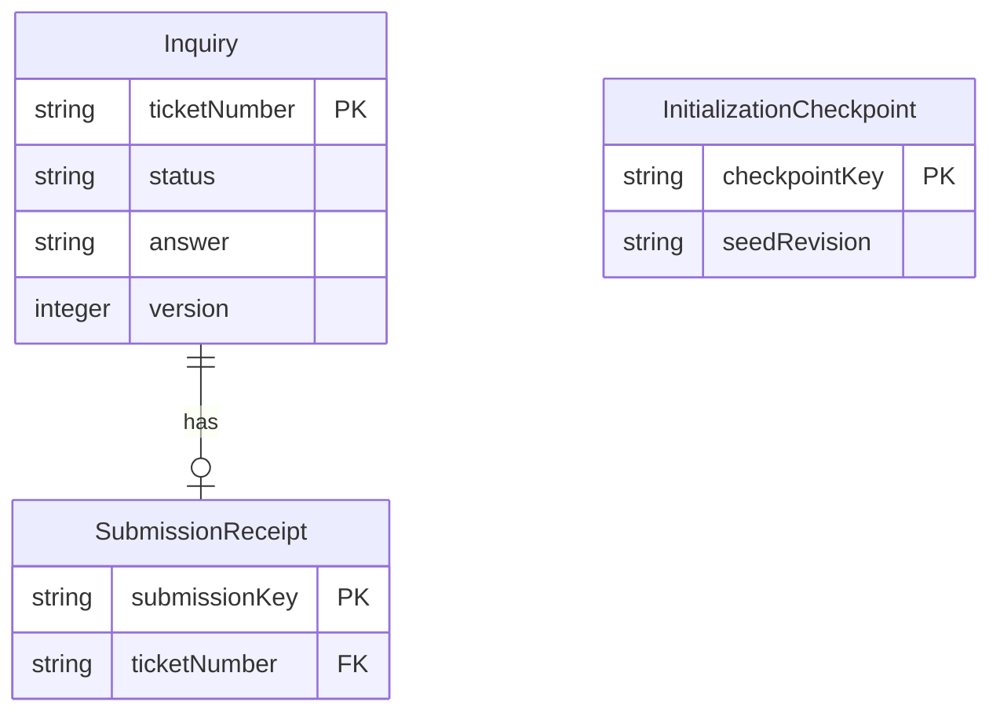
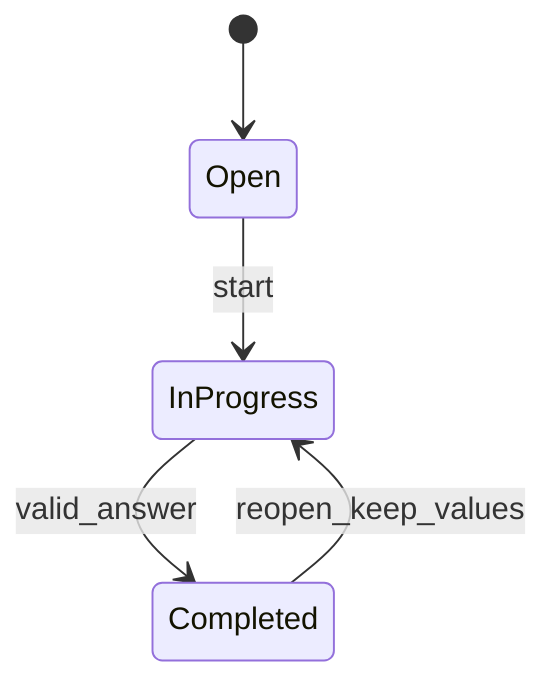

# DeskFlow：機能仕様

## Sources

- [実装単位](../../../inception/units-generation/unit-of-work.md)、[要件割当](../../../inception/units-generation/unit-of-work-story-map.md)：u1-deskflowが全23件の下位FRを担当する。
- [要件](../../../inception/requirements-analysis/requirements.md)、[コンポーネント](../../../inception/domain-design/components.md)。
- [回答](functional-design-questions.md)：Q1=A、Q2=A、Q3=A。
- [データ形状の正本](entities.md)、[判断ロジックの正本](rules.md)。

## Specification Boundary

本書は操作順序と状態遷移の正本。データ形状はentities.md、判断はrules.mdを参照する。User Storiesと単位間の契約工程は計画上省略されており、USや外部APIを新設しない。言語、通信形式、保存製品、物理スキーマ、具体的なコマンドは後工程で決める。

DeskFlowInterfaceが入力と表示を担当し、InquiryManagementが業務判断と正式保存を所有する。InquiryManagementが保存側の入力検証を必ず行い、画面を経由しない要求にも同じルールを適用する。実在利用者の認証は対象外。文字は実行可能な表示へ変換しない。

## Entity Relationship View

entities.mdから導いた参照図。初期問い合わせには受付記録がなく、初期化完了記録は個別問い合わせへの外部参照を持たない。

テキストによる説明：受付記録は必ず1件の問い合わせを参照し、問い合わせ側の受付記録は0または1件。初期化完了記録は独立した全体記録である。属性の抜粋図であり、全項目はentities.mdを参照する。

## Workflow W1：登録と再送

1. 社員入口から登録画面を開き、新しい登録操作キーを準備する。必須3項目と任意分類を入力する。
2. 送信開始時に入力の組を固定し、処理中表示と重複操作の抑制を行う。InquiryManagementが型・必須・書記素数・選択肢を検証する（BR1.1）。
3. 同じキーで受付済みなら、内容指紋を照合する。同内容なら既存受付番号を返し、異内容なら競合として拒否する（BR1.3）。
4. 未受付なら、番号を一意に採番し、InquiryとSubmissionReceiptを1回の不可分な保存で確定する。時刻は管理側で付与する。並行する同じキーの要求も一意制約と不可分性で高々1件にする。
5. 確定した結果だけを受けて、同じ画面に受付番号と登録内容を表示する。初期状態は未対応・未割当・回答空（BR1.2、BR7.1）。
6. 「別の問い合わせを登録する」で空の入力と新しいキーへ切り替える。同内容の別件も新しい操作として受け付ける。成功した内容を再送する通常ボタンは置かない（Q2=A、BR8.1）。

失敗分岐：入力不備は欄を示して入力を保持する。保存の確定失敗は入力を保って同じ操作を再試行できる。応答喪失など結果不明の間はキーと送信内容を保持し、同じ組で再照合する。結果不明のまま内容を変更して同じキーを再利用しない。確定した失敗を確認して修正する場合は新しい操作キーを用意し、未受理の旧操作を自動再送しない。未保存移動は戻る・破棄して移動を選ぶ。

## Workflow W2：対応保存・完了・再開

1. 一覧から詳細を開き、正式な現在値とversionを取得する。存在しない場合は未検出の案内と一覧へ戻る操作を表示する。
2. 未対応・対応中では担当、状態、回答を編集できる。登録時の4項目は参照専用とする。画面は表示時点のversionを期待版として保持する。
3. 保存側は要求形式と対象の存在を確認し、期待版を照合する。古い版は変更の有無の判定より先に競合として拒否する。
4. 現在の状態を基準に編集可能性、許可遷移、担当固定値、回答の長さと完了条件を検証する。担当未割当でも有効な回答で完了できる。
5. 最新版で検証済みの値が同じなら「変更はありません」と返し、version・updatedAtを変えない（Q3=A）。完了中は対応編集の保存操作を提供せず、直接の編集要求も拒否する。
6. 実変更なら期待版の一致を保存時にも保証し、担当・状態・回答・version・updatedAtを不可分に更新する。他の保存が先行したら競合とする。
7. 保存確定後だけ最新値で画面を更新し、未保存状態を解除する。保存失敗では入力と既存の正式記録を保持する。
8. 完了時は担当と回答を参照表示し、「対応中へ再開する」だけを提示する。再開は期待版を照合して状態だけを更新し、既存担当と回答を保持する。再開成功後に別の保存操作で編集する。

競合分岐：古い入力を保持したまま、競合の説明と「最新内容を確認する」を提示する。最新値の再読込で入力を黙って破棄せず、入力中の値と最新の保存値を別に示す。本人が見直した値を、新しい期待版で明示的に再保存する。自動マージ・自動上書きは行わない。結果不明の保存は最新値を読み直して確認し、古い期待版の操作を自動再送しない。

## State Machine

| 保存前 | 操作・保存後 | 条件 |
|---|---|---|
| 未対応 | 未対応のまま保存 | 担当固定値、回答0〜2000文字、版一致 |
| 未対応 | 対応中 | 同上 |
| 対応中 | 対応中のまま保存 | 同上 |
| 対応中 | 完了 | 有効な回答1〜2000文字。担当未割当も可 |
| 完了 | 対応中へ再開 | 状態だけ変更、担当・回答を保持、版一致 |

テキストによる説明：通常登録は未対応。未対応→対応中→完了、完了→対応中の再開だけを許可する。未対応と対応中の同じ状態での編集保存は遷移ではない。初期データだけは3状態を直接用意する。全逆戻り・飛ばしと定義外の状態は拒否する。

## Workflow W3：一覧・検索・詳細から戻る

1. 窓口入口では空検索語・全件・1ページ目で開始する。検索入力の前後空白を除き、100書記素以内と有効な状態を検証する。
2. 検索語と検索対象値だけをNFKC正規化し、大文字・小文字を区別せず部分一致で比較する。件名・本文・回答・申請者名・担当者表示名のいずれかに一致すれば語の条件を満たす。未割当の表示名も同じ比較対象とする。保存値は変更しない。
3. 状態と語をANDで併用する。語の内部空白では分割しない。条件変更・解除は1ページ目へ戻す。
4. createdAt降順、同時刻は受付番号の数値部分降順で固定する。同じ読取結果に対し総件数とページを求め、1ページ20件を表示する。表示後に登録・更新された結果は次の明示的な取得で反映する。
5. 0件では「データなし」と「条件一致なし」を区別する。読込失敗はエラーとして再試行を示し、完全な結果として0件や一部の件数を返さない。
6. 詳細へ進む時点の検索語・状態・ページを一時状態に保つ。閲覧だけでは問い合わせの版も時刻も変えない。
7. 一覧へ戻ると同じ条件とページで正式データを再取得する。更新によってそのページが消えた場合は最後の有効ページへ補正した旨を示す。空なら0件表示とする。

遅く届いた古い検索応答が新しい条件の結果を上書きしないよう、画面は最後の要求の結果だけを採用する。古い表示のまま取得に失敗したら更新失敗を文字で明示し、最新の一覧とは表示しない。

## Workflow W4：初期化と再起動

1. 保存先の読込に成功してから初期化完了記録を確認する。読込失敗を新規の空保存先とみなさない。
2. 完了記録があれば何も投入せず既存値を使用する。記録なし・既存問い合わせありは不整合とし、起動を中止して保守用の確認を案内する。
3. 新規なら10件を固定のDF-000001〜DF-000010で用意する。未対応4件、対応中3件、完了3件を演習用の設計例とし、各分類と未割当・担当者を含める。完了には有効な架空回答を持たせる。これは回答とは別のサンプル構成の設計である。
4. 10件と完了記録を不可分に保存する。複数の初期化が競合しても完了記録の一意性で二重投入しない。失敗なら完成扱いにせず起動エラーを示す。
5. 通常再起動では既存の入力・更新・受付記録を読み、初期投入を繰り返さない。復旧は通常画面の操作に追加せず、別途説明・本人判断を経た保守手順へ引き継ぐ。

## Internal Operations and Failure Results

共通の追加受入条件：変更要求のJSON本文全体はUTF-8で65536バイト以下とする。付帯項目・JSONエスケープを含む実際の本文を計測し、65537バイト以上は保存前に拒否する。文字数が上限内でも対象となり、入力を保持して「送信データ量が上限を超えています」と修正を案内する。画面は送信するJSON本文で同じ検査を行う。根拠：[ローカル実行環境Q2=A](../infrastructure-design/infrastructure-design-questions.md)。W1の登録手順2とW2の対応保存手順3に入る前に適用し、不正な受信を業務処理へ渡さない。再開などの変更要求にも同じ上限を適用する。

外部公開の契約ではなく、2つのコンポーネント間の論理的受け渡しを示す。

| 操作 | 入力 | 正常結果 | 主な失敗 |
|---|---|---|---|
| 登録 | 登録4項目、操作キー | 新規または再送の受付番号・登録内容 | 入力不備、キー競合、保存失敗、結果不明 |
| 対応保存 | 受付番号、期待版、担当・状態・回答 | 保存後の現在値と版、または変更なし | 未検出、版競合、編集不可、遷移・入力不備、保存失敗、結果不明 |
| 再開 | 受付番号、期待版 | 担当・回答を保持した対応中の現在値 | 未検出、版競合、完了以外、保存失敗、結果不明 |
| 一覧検索 | 検索語、状態、ページ | 適用条件、補正ページ、総件数、20件以内の一覧 | 条件不備、読込失敗 |
| 詳細参照 | 受付番号 | 現在値と版 | 未検出、読込失敗 |
| 固定値参照 | なし | 分類・担当・状態のコードと表示名 | 読込失敗 |

型不正、欠けた必須値、定義外の列挙値、受付番号以外の対象指定は保存側で拒否する。永続記録の破損・参照切れは正常な空表示に置き換えず、不整合として記録と案内を行う。本文・回答をそのままログへ出さない。エラーの具体的形式と待ち時間の上限は品質設計で定める。

## Derived Rules Summary and Coverage

| 機能 | 参照ルール | 確認する境界例 |
|---|---|---|
| 登録 | BR1.1〜BR1.3 | 空白、最大長、1文字超過、結合文字、同内容別件、二重送信、応答喪失 |
| 担当・状態・回答 | BR2.1〜BR3.3、BR7.1〜BR7.2 | 未割当完了、空回答、禁止遷移、完了後編集、再開、変更なし、同時更新 |
| 一覧・検索 | BR4.1〜BR5.2 | 0/1/20/21/100件、同時刻、全角半角、複数条件、戻り、範囲外ページ |
| 初期化・永続化 | BR6.1、BR7.1 | 初回10件、失敗・中断、再起動11件、更新保持、不整合 |
| 操作結果と移動 | BR8.1〜BR8.2 | 入口分岐、未保存離脱、入力保持、読込失敗、正常0件、キーボード |

[traceability.json](traceability.json)で下位FR23件を実在BRに対応させる。性能目標、ループバック、アクセシビリティの確認、行カバレッジ80%以上、復旧、ログの具体化はNFR Requirements以降へ引き継ぐ。ここでは実装もテスト実行も行っていない。

## Assumptions & Open Questions

追加の境界確認として、書記素数内でも結合記号等によりJSON本文が65536/65537バイトになる要求を作り、前者を他の入力条件も満たす場合に許可、後者を拒否すること、問い合わせが変わらず画面入力が残ることを確認する。通常の文字数上限・再送・競合の確認も維持する。

None. 技術選定と保存方式は後続工程の決定事項。サンプルの状態配分、比較の順序、異内容再送の拒否、ページ補正は既存要件を満たす設計上の具体化として明示した。
