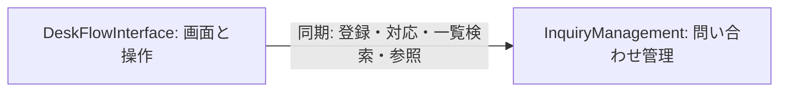

# DeskFlow：論理コンポーネントとデータ所有

## Sources

- [承認済みの要件](../requirements-analysis/requirements.md)：FR1.1〜FR8.2、NFR1〜NFR7。
- [承認済みの開発方針](../practices-discovery/team-practices.md)：各層の実装後にテスト、ローカル限定、本人の工程・コード計画承認。
- [本工程の回答](domain-design-questions.md)：Q1=A、Q2=A、Q3=A。
- [設計判断の記録](decisions.md)と[要件との対応](traceability.json)。

## Component Catalogue

以下のカタログをコンポーネント名・呼び出し関係・エンティティ所有の正本とする。エンティティは識別属性・項目名・参照だけを示す。型、制約、列定義、関連の多重度は後の機能設計で定める。

```yaml
components:
  - name: DeskFlowInterface
    summary: 社員と窓口担当者の画面表示および操作の流れを扱う
    behaviour: >
      入口、登録、一覧検索、詳細対応を表示する。
      入力や検索条件、ページ、未保存状態を画面上で扱い、問い合わせ管理へ処理を依頼する。
      処理結果を受け取って成功、入力不備、競合、保存失敗、読込中、0件を区別する。
      閲覧だけでは更新せず、保存成功が確認できる前に成功と表示しない。
      問い合わせの正式な記録や業務ルールを独立して変更しない。
    responsibilities:
      - 役割の入口と4画面の構成
      - 入力補助、未保存の案内、処理結果の表示
      - 検索条件とページを保つ画面移動
      - ラベル、キーボード操作、状態を文字で示す表示
    depends_on:
      - component: InquiryManagement
        interaction: 登録、担当と回答と状態の更新、再開、一覧検索、詳細参照、固定選択肢の取得を依頼して結果を受け取る
        style: sync
    dependents: []
    external_dependencies:
      - name: BrowserRuntime
        kind: other
        purpose: WindowsのPCブラウザーで表示と操作を行う実行環境
    entities: []
  - name: InquiryManagement
    summary: 問い合わせの記録と業務ルール、一覧検索、保存の一貫性を管理する
    behaviour: >
      登録時の入力と固定選択肢を検証し、受付番号を持つ問い合わせを作成する。
      担当、状態、現在の回答を同じ問い合わせとして扱い、完了と再開の規則を一元的に守る。
      要件で認められた未割当の完了を扱い、再開しても既存の担当や回答を消さない。
      検索の文字比較、条件併用、新しい順の安定した並び、ページ分割を行う。
      登録の再試行、古い更新、初期データの再投入を識別し、永続化の成否と整合した結果だけを返す。
    responsibilities:
      - 問い合わせと現在の回答の唯一の管理責任
      - 固定の担当者と分類の参照データ
      - 正式な入力検証と完了と再開の業務ルール
      - 登録の重複防止、更新の競合判定、一括保存の境界
      - 一覧検索と読取結果の生成
      - 初回データ投入の状態管理
      - 永続化との受け渡しと失敗結果の分類
    depends_on: []
    dependents:
      - component: DeskFlowInterface
        interaction: 登録と対応と一覧検索と参照の処理結果を画面へ返す
    external_dependencies:
      - name: LocalPersistence
        kind: other
        purpose: 問い合わせと登録受付と初期化状態を保存する依存先であり、具体的な技術と形式は後工程で決める
    entities:
      - name: Inquiry
        identifier: ticketNumber
        attributes:
          - ticketNumber
          - requesterName
          - subject
          - description
          - categoryCode
          - assigneeCode
          - status
          - answer
          - createdAt
          - updatedAt
          - version
      - name: SubmissionReceipt
        identifier: submissionKey
        attributes:
          - submissionKey
          - payloadFingerprint
          - ticketNumber
          - acceptedAt
      - name: InitializationCheckpoint
        identifier: checkpointKey
        attributes:
          - checkpointKey
          - seedRevision
          - initializedAt
```

## Component Diagram



テキストによる説明：画面のDeskFlowInterfaceだけがInquiryManagementを呼び出し、処理結果を受け取って表示する。問い合わせ管理から画面への呼び出しはなく、循環しない。外部依存先はコンポーネントのノードに含めない。

## Component Summary

| Component | Purpose | Depends On | Dependents | Entities Owned |
|---|---|---|---|---|
| DeskFlowInterface | 画面表示、入力補助、結果と未保存状態の案内、検索条件を保つ移動 | InquiryManagement | なし | なし |
| InquiryManagement | 問い合わせの業務ルールと保存責任、一覧検索、固定参照データ | なし | DeskFlowInterface | Inquiry、SubmissionReceipt、InitializationCheckpoint |

画面の入力中の値や検索条件は一時的な表示状態であり、別の問い合わせの正本や永続エンティティとして扱わない。4画面の見せ方は承認済みの画面案を引き継ぐ。

## Entity Ownership

| Entity | Owning Component | Identifier | Attributes | References |
|---|---|---|---|---|
| Inquiry | InquiryManagement | ticketNumber | ticketNumber、requesterName、subject、description、categoryCode、assigneeCode、status、answer、createdAt、updatedAt、version | categoryCodeとassigneeCodeは同じ所有者が持つ固定参照データを表す |
| SubmissionReceipt | InquiryManagement | submissionKey | submissionKey、payloadFingerprint、ticketNumber、acceptedAt | ticketNumberは同じ所有者のInquiryを参照する |
| InitializationCheckpoint | InquiryManagement | checkpointKey | checkpointKey、seedRevision、initializedAt | 他コンポーネントのエンティティ参照なし |

Inquiryが現在の回答を項目として保持する。SubmissionReceiptはFR1.4の同じ登録操作の再試行を識別するため、InitializationCheckpointはFR6.1・FR6.2の初回投入だけを実行するための管理記録である。これらの記録を利用者向けの新機能として公開しない。

固定の担当者と分類は問い合わせ管理の参照定義として扱い、独立した利用者・担当者アカウントや管理画面を持つエンティティにはしない。問い合わせの値と固定定義の具体的な対応、受付番号の形式、更新版の扱いは機能設計で具体化する。

## External Dependencies

| Component | Dependency | Kind | Purpose |
|---|---|---|---|
| DeskFlowInterface | BrowserRuntime | other | 承認済みのPCブラウザーで表示・操作するための環境 |
| InquiryManagement | LocalPersistence | other | 問い合わせと管理記録をローカルで永続化するための依存先 |

LocalPersistenceは実装上の入出力先を表す論理的な名前であり、データベース製品やファイル形式を選択したものではない。永続化を抽象化するためのコードはInquiryManagementの実装内部で扱い、データの正式な所有者を移さない。

## Interaction and Ownership Rules

- DeskFlowInterfaceは処理を同期的に依頼し、成功または失敗を受け取る。画面表示用の処理中状態は、この呼び出しを待つ間の表示であり、非同期に業務を受け付けたという意味ではない。
- 保存する側の正式な入力検証、状態変更、完了・再開の判定はInquiryManagementが行う。画面の入力補助だけを信用しない。
- Inquiryの担当・状態・現在の回答の更新と更新版の確認は、同じ業務保存の境界で扱う。LocalPersistenceは必要な一貫性を実現できる方式として後で選択する。
- 同じ登録の再試行の判定と問い合わせの新規保存を、成功結果と矛盾しない境界で扱う。受付記録だけ、または問い合わせだけが完成したことにしない。
- 初回データと初期化状態も、中断して半端な投入を完成扱いしない境界で扱う。再起動時に既存データを初期値へ戻さない。
- 一覧と検索は同じ正式な問い合わせを読む。検索専用の別の正本や遅れて同期するデータは持たない。
- エラーは入力不備・見つからない・競合・保存や読込の失敗を区別した結果とし、画面がそれに対応する案内を表示する。エラーコードやデータ形式は後の設計で定める。

根拠：FR1.4、FR3、FR5、FR6、FR7、FR8、NFR2・NFR3と本工程の引き継ぐ決定。

## Rationale

| Component | 分ける理由 | 引き受けるトレードオフ |
|---|---|---|
| DeskFlowInterface | 画面の配置・操作状態・アクセシビリティを、問い合わせの業務ルールとは別に変更・確認できる | 業務結果を画面の状態に変換する受け渡しが必要になる |
| InquiryManagement | 同じ問い合わせに関する入力検証・更新・回答・検索を、1つの所有責任に集約できる | 検索が将来大きく変わる場合は、この責任を再分割する判断が必要になる |

### 比較した分け方

| 案 | 利点 | 欠点・可逆性 | 採否 |
|---|---|---|---|
| 画面＋問い合わせ管理 | 呼び出し先と所有責任が少なく、同じ記録の更新・検索を一貫させやすい | 業務処理が集まる。検索は後で分離できる | 本人Q1=Aに基づき採用 |
| 画面＋問い合わせ管理＋検索 | 検索の責任を独立して確認しやすい | 読取用データの受け渡しと境界が増える。後でまとめ直せる | Alternatives Rejected：初回の100件・1人の演習では独立境界の必要性が小さいため不採用 |
| 固定参照データの専用コンポーネント追加 | 選択肢の管理責任を独立させられる | 固定リストだけのために呼び出しが増える | Alternatives Rejected：本人Q3=Aと、管理機能を追加しない境界に従い不採用 |

詳細な比較と所有判断は[設計判断の記録](decisions.md)に示す。

## 要件との対応

| 要件群 | 主な実現責任 | 補足 |
|---|---|---|
| FR1・FR2・FR3 | InquiryManagement | DeskFlowInterfaceが入力と処理結果を表示する |
| FR4・FR5 | InquiryManagement | 同じ正本を用いた一覧・検索結果をDeskFlowInterfaceが表示する |
| FR6・FR7 | InquiryManagement | 永続化との受け渡し、初期化・重複・競合を扱う |
| FR8 | DeskFlowInterface | 業務の成否はInquiryManagementの結果に従う |
| NFR1 | 両コンポーネント | 性能の目標と測定条件は維持し、方式と測定手順は品質設計で具体化する |
| NFR2・NFR3 | InquiryManagementと画面の境界 | 保存側の検証、成功・失敗の区別、文字表示。待受先等は環境設計へ引き継ぐ |
| NFR4 | DeskFlowInterface | キーボード・表示の確認へつなぐ |
| NFR5 | 両コンポーネント | 実装後の単体・結合テストとカバレッジ計測の対象へつなぐ |
| NFR6・NFR7 | InquiryManagementとローカル実行環境 | 保存先の所有、運用時の成否確認。手順やログ方式は後工程で決める |

FRの下位23件の個別対応はtraceability.jsonに記録する。言語、フレームワーク、具体的な保存方式、配備単位、品質パターン、公開API・メソッドの契約は本工程で確定しない。

## Assumptions & Open Questions

None.
